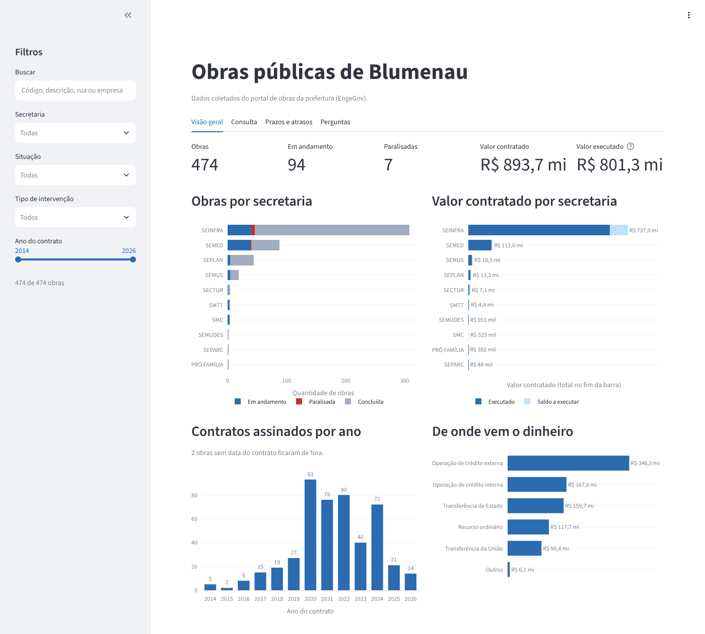
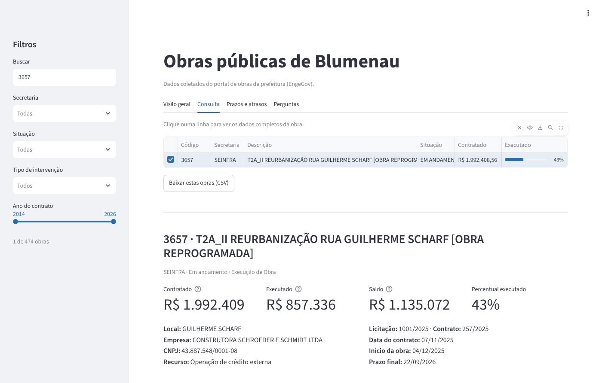
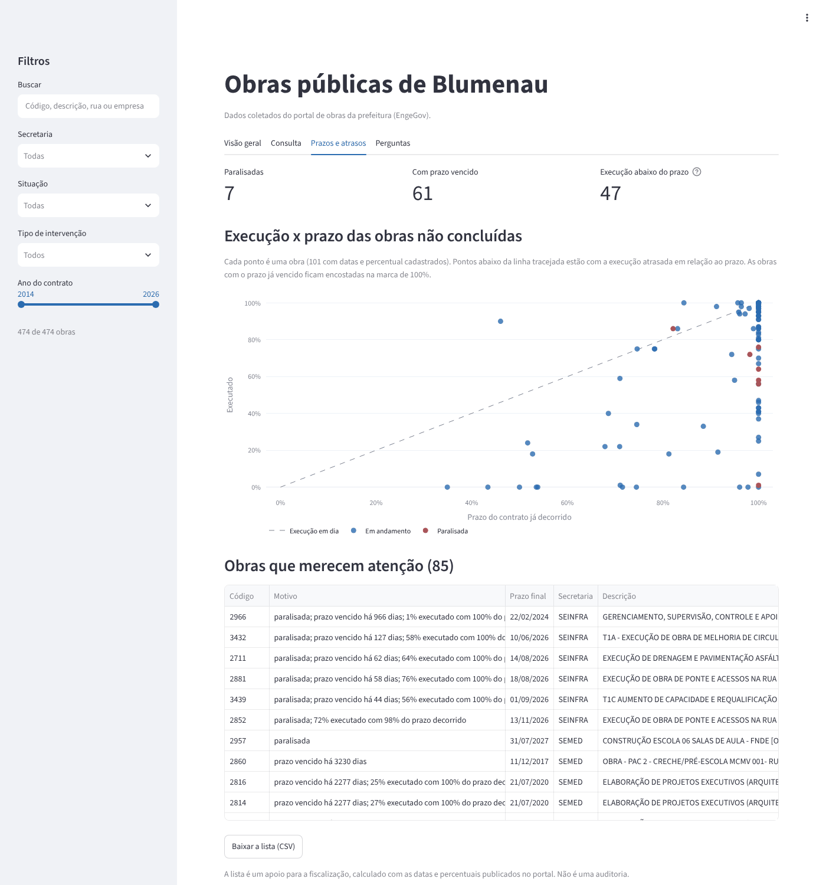
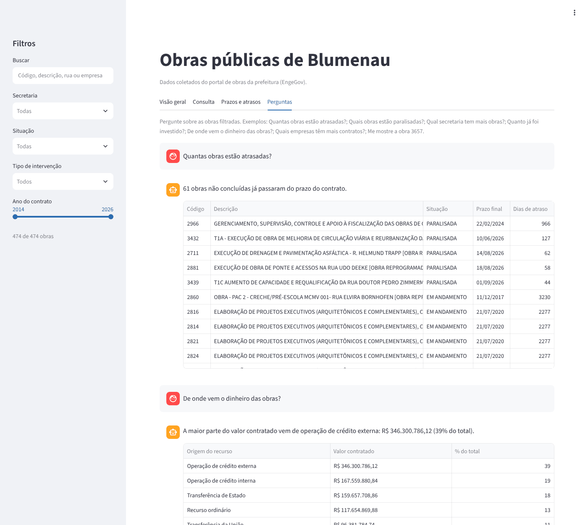

# Painel de Obras Públicas de Blumenau

Projeto em **Python** que coleta os dados das obras públicas da Prefeitura de Blumenau por *web scraping*, grava tudo num banco **MySQL**, disponibiliza os dados numa **API REST em Flask** e mostra um **painel em Streamlit** com gráficos, consulta de obras, acompanhamento de prazos e perguntas em português. Foi um trabalho em equipe do curso **Python para Inteligência Artificial** do **Entra21** (Blusoft e ACATE), em 2026.

> **English:** Python project (team work, Entra21 Python for AI course, 2026) that scrapes Blumenau's public works portal (JSF/PrimeFaces, with ViewState handling), stores the data in MySQL, serves it through a Flask REST API and shows it in a Streamlit dashboard: charts by department, a searchable table with full contract details, a schedule check that flags stalled, overdue or delayed works, and an AI assistant: Llama 3.3 (via Groq) maps each Portuguese question to one of eight predefined pandas queries, so every number comes from the data, with a keyword fallback when no API key is set.



## Arquitetura

```
obras_disponiveis.xls ──► processar_obras.py ──► scraper.py ──► portal EngeGov (prefeitura)
                                   │
                                   ▼
                           inserir_banco.py ──► MySQL (tabela obras)
                                                   │
                                   ┌───────────────┴───────────────┐
                                   ▼                               ▼
                            api.py (Flask)               app.py (Streamlit)
```

## Como funciona

### 1. Coleta

O portal EngeGov é feito em JSF com PrimeFaces, então não basta baixar o HTML da página. O site guarda o estado da tela num campo oculto, o `javax.faces.ViewState`, e cada busca é uma requisição AJAX que devolve XML com pedaços de HTML dentro.

- `scraper.py` abre uma sessão, lê o ViewState inicial e, para cada código, filtra a tabela de obras e depois simula o clique na linha da obra, que abre os painéis de contrato e de andamento. A cada resposta o ViewState é atualizado.
- No painel de contrato, cada campo é um par de rótulo e valor (por exemplo "Término Contrato:" e "06/09/2025"). No painel de andamento, os valores ficam ao lado de cada rótulo e o percentual executado fica no gráfico circular da página. Daí saem a empresa, o CNPJ, os números da licitação e do contrato, as datas, o tipo de recurso e os valores contratado e executado.
- Algumas datas estão digitadas errado no próprio portal, como 16/05/0202. Essas ficam em branco, para não estragar as contas de prazo.
- `processar_obras.py` lê os 483 códigos da planilha `obras_disponiveis.xls`, exportada do portal, e grava cada obra no banco. Na coleta de outubro de 2026, 474 deles ainda estavam no portal. Se uma requisição falhar, a sessão é aberta de novo e a coleta continua. No fim, mostra quantas obras foram gravadas, quantas não foram encontradas e quais deram erro.

### 2. Banco de dados

`inserir_banco.py` usa `INSERT ... ON DUPLICATE KEY UPDATE` com chave única no código da obra. Assim, rodar a coleta de novo atualiza as obras em vez de duplicar.

### 3. API REST

| Rota | Retorno |
|---|---|
| `GET /` | Status da API |
| `GET /obras` | Todas as obras. Aceita `?situacao=` e `?secretaria=` |
| `GET /obras/<código>` | Uma obra, ou 404 se não existir |

### 4. Painel

Os filtros da barra lateral (busca, secretaria, situação, tipo de intervenção e ano do contrato) valem para as quatro abas. A busca procura no código, na descrição, na rua e na empresa, e ignora acentos: "construcao" encontra "CONSTRUÇÃO".

- **Visão geral:** totais de obras e valores, obras por secretaria separadas por situação, valor contratado por secretaria dividido em executado e saldo, contratos assinados por ano e de onde vem o dinheiro (recurso próprio, operação de crédito, transferência da União ou do Estado).
- **Consulta:** tabela das obras filtradas. Ao clicar numa linha aparecem os dados completos do contrato. Os resultados podem ser baixados em CSV no formato que o Excel em português abre direto.
- **Prazos e atrasos:** compara o percentual executado com o percentual do prazo do contrato que já passou. A obra não concluída entra na lista de atenção quando está paralisada, quando o prazo final já venceu ou quando a execução está 20 pontos ou mais abaixo do prazo decorrido. A lista mostra o motivo de cada obra.
- **Perguntas:** um assistente com IA responde perguntas em português, como "Tem alguma obra parada?" ou "Qual secretaria gastou mais?". O modelo **Llama 3.3, pela API da Groq**, lê a pergunta e escolhe uma entre oito consultas prontas, com os parâmetros (situação, métrica, código da obra). A consulta roda com pandas sobre os dados do banco, então os números da resposta são sempre os reais e o modelo não tem como inventar valores nem montar SQL. Abaixo de cada resposta aparece como a pergunta foi entendida. Sem a chave da Groq, ou se a API não responder, o assistente continua funcionando com palavras-chave.

| Consulta | Prazos e atrasos | Perguntas |
|---|---|---|
|  |  |  |

*Capturas com os dados reais do portal, coletados em 15/10/2026.*

## Como rodar

1. Instale as dependências.
   ```bash
   python -m venv .venv
   source .venv/bin/activate        # no Windows: .venv\Scripts\activate
   python -m pip install -r requirements.txt
   ```
2. Crie o banco e a tabela.
   ```bash
   mysql -u root -p < schema.sql
   ```
3. Copie o `.env.example` para `.env` e preencha a senha do MySQL. Para o assistente usar IA, coloque também a chave gratuita da [Groq](https://console.groq.com) em `GROQ_API_KEY`. O `.env` está no `.gitignore` e não vai para o repositório.
4. Rode os comandos a partir da pasta raiz do projeto.
   ```bash
   python backend/processar_obras.py    # coleta as obras e grava no banco
   python backend/api.py                # API em http://localhost:5000
   streamlit run frontend/app.py        # painel em http://localhost:8501
   ```

Para testar a coleta com poucas obras, use `python backend/processar_obras.py --limite 5`. O painel lê direto do MySQL, então a API não precisa estar rodando para ele funcionar.

### Sem MySQL

O repositório traz em `exemplo/obras.csv` as 474 obras coletadas do portal em 15/10/2026. Para abrir o painel com esses dados, sem MySQL e sem rodar a coleta, coloque `OBRAS_CSV=exemplo/obras.csv` no `.env` e rode `streamlit run frontend/app.py`.

A coleta também pode gravar num CSV em vez do banco:

```bash
python backend/processar_obras.py --csv obras.csv
```

## Testes

```bash
python -m unittest discover -s tests -v
```

São 27 testes que rodam sem internet e sem banco. Os do scraper usam respostas com a mesma estrutura do HTML que o portal devolve. Os do painel usam obras fictícias e cobrem a formatação em reais, os filtros, a regra de prazos, o assistente (com a resposta da Groq simulada) e os gráficos.

## Estrutura

```
painel-obras-blumenau/
├── backend/
│   ├── scraper.py            # sessão, ViewState e leitura dos painéis do portal
│   ├── processar_obras.py    # lê a planilha de códigos e coordena a coleta
│   ├── inserir_banco.py      # grava ou atualiza cada obra no MySQL
│   ├── database.py           # conexão com o banco (credenciais do .env)
│   ├── salvar_resposta.py    # salva a resposta do portal de uma obra, para conferir o HTML
│   └── api.py                # API REST em Flask
├── frontend/
│   ├── app.py                # telas do painel
│   ├── dados.py              # leitura do banco e filtros
│   ├── prazos.py             # regra de atenção aos prazos
│   ├── graficos.py           # gráficos em Plotly
│   ├── assistente.py         # perguntas em português
│   └── formatar.py           # reais, datas e percentuais no padrão brasileiro
├── tests/                    # testes automatizados
├── docs/                     # capturas de tela
├── exemplo/obras.csv         # obras coletadas em 15/10/2026, para rodar sem MySQL
├── .streamlit/config.toml    # tema do painel
├── obras_disponiveis.xls     # lista de obras exportada do portal
├── schema.sql
├── .env.example
└── requirements.txt
```

## O que eu faria diferente hoje

Revisei o projeto depois da entrega e corrigi vários problemas:

- O scraper gravava o valor executado e o percentual como zero em todas as obras, porque no HTML do portal esses rótulos são quebrados em duas linhas ("Valor" numa, "Executado" na outra). Também não lia o número da licitação nem o tipo de recurso. Refiz a leitura dos painéis com base no HTML real.
- Os filtros escondiam as obras sem data, e a consulta quebrava quando a obra selecionada saía do filtro.
- O assistente só funcionava com chave de API e não avisava quando a Groq falhava. Agora ele mostra como entendeu cada pergunta e tem palavras-chave como reserva.
- Os gráficos repetiam a mesma informação e, com a execução zerada, não mostravam nada útil.
- O painel era um arquivo único de 1.600 linhas. Separei em módulos e acrescentei os testes.

Ainda daria para melhorar:

- **Verificação SSL.** O scraper usa `verify=False`, que desliga a checagem do certificado do portal. O certo seria manter a verificação e apontar para a cadeia de certificados correta.
- **Teste com o site de verdade.** Os testes do scraper rodam sem internet. Um teste extra, rodado de vez em quando contra o portal, avisaria na hora quando o site mudar.
- **Nomes de campo fixos.** Alguns campos do formulário do portal têm nomes gerados pelo JSF, como `j_idt122`. Se a prefeitura atualizar o site, esses nomes mudam. O scraper poderia lê-los da página inicial em vez de deixá-los fixos no código.
- **Histórico.** A coleta poderia rodar sozinha toda semana e guardar cada versão da obra, para acompanhar a evolução da execução ao longo do tempo.

---

Projeto desenvolvido em equipe. Repositório mantido por **Isadora Fernanda Zappe Schmidt** · [LinkedIn](https://www.linkedin.com/in/isadora-fernanda)
