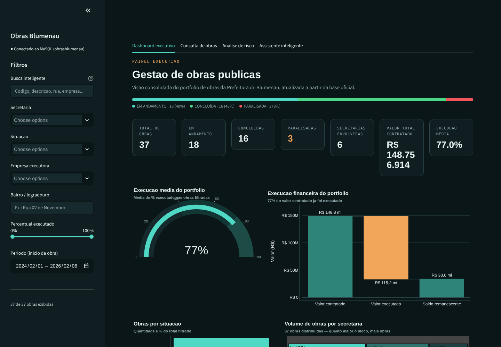
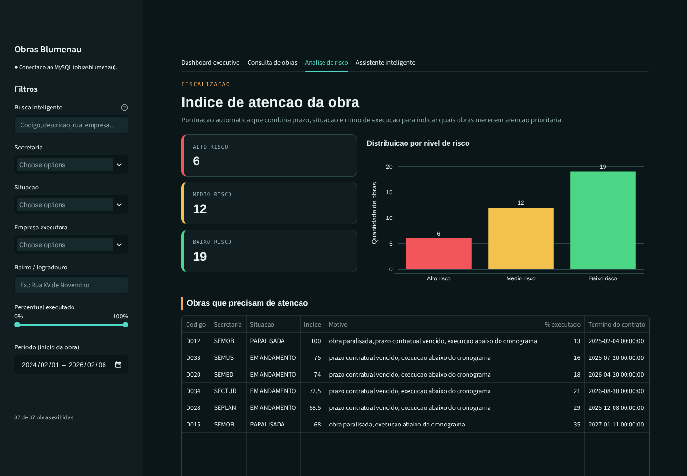

# Painel de Obras Públicas de Blumenau

Projeto completo em **Python** que coleta os dados das obras públicas da Prefeitura de Blumenau por *web scraping*, grava tudo num banco **MySQL**, disponibiliza os dados numa **API REST em Flask** e apresenta um **painel interativo em Streamlit** com gráficos, análise de risco e um assistente que responde perguntas em português com IA.

> **English:** End-to-end Python project that scrapes Blumenau's public works portal (a JSF/PrimeFaces site with ViewState handling), stores the data in MySQL, exposes it through a Flask REST API and presents it in a Streamlit dashboard with Plotly charts, a risk score for each project and an AI assistant (Groq) that maps natural-language questions to safe, pre-defined pandas queries.



*Capturas feitas com **dados fictícios** de demonstração. O painel real usa os dados coletados do portal.*

## Arquitetura

```
obras_disponiveis.xls ──► processar_obras.py ──► scraper.py ──► portal EngeGov (prefeitura)
                                   │
                                   ▼
                           inserir_banco.py ──► MySQL (tabela obras)
                                                   │
                                   ┌───────────────┴───────────────┐
                                   ▼                               ▼
                            api.py (Flask)               app.py (Streamlit)
                         GET /obras, /obras/<código>   dashboard, consulta, risco, IA
```

## Como funciona

### 1. Coleta (scraping)

O portal EngeGov é feito em JSF com PrimeFaces, então não basta baixar o HTML de uma página. O site guarda o estado da tela num campo oculto, o `javax.faces.ViewState`, e cada busca é uma requisição AJAX que devolve XML com pedaços de HTML dentro.

- `scraper.py` abre uma sessão com `requests.Session`, lê o ViewState inicial e, para cada código, simula o filtro da tabela de obras. Depois simula o clique na linha da obra para receber os painéis de contrato e de andamento.
- A cada resposta o ViewState é atualizado, para a sessão continuar válida.
- Os dados de contrato (empresa, CNPJ, licitação, datas, tipo de recurso) e de andamento (valor executado, percentual) são extraídos com BeautifulSoup e expressões regulares. Valores em reais e datas no formato brasileiro são convertidos para número e para `AAAA-MM-DD`.
- `processar_obras.py` lê os 483 códigos da planilha `obras_disponiveis.xls` (exportada do portal), busca cada obra e grava no banco. Se uma requisição falhar, a sessão é recriada e o processamento continua.

### 2. Banco de dados

`inserir_banco.py` usa `INSERT ... ON DUPLICATE KEY UPDATE` com chave única no código da obra. Assim, rodar a coleta de novo atualiza as obras em vez de duplicar.

### 3. API REST (Flask)

| Rota | Retorno |
|---|---|
| `GET /` | Status da API |
| `GET /obras` | Todas as obras em JSON |
| `GET /obras/<codigo>` | Uma obra, ou 404 se não existir |

### 4. Painel (Streamlit e Plotly)

O painel tem filtros na barra lateral (busca livre, secretaria, situação, empresa, logradouro, percentual executado e período) que valem para todas as abas.

- **Dashboard executivo**: indicadores (total de obras, em andamento, concluídas, paralisadas, valor contratado, execução média), velocímetro de execução, cascata financeira (contratado, executado e saldo), mapa de árvore por secretaria, mapa de calor secretaria por situação, linha do tempo acumulada e ranking dos locais com mais investimento.
- **Consulta de obras**: tabela com detalhe completo da obra selecionada e exportação dos resultados filtrados em CSV.
- **Análise de risco**: um índice de 0 a 100 que aponta as obras que merecem atenção. Ele soma pontos quando a obra está paralisada, quando o prazo do contrato já venceu e quando a execução está atrasada em relação ao tempo decorrido do contrato. Acima de 30 a obra é de médio risco, e acima de 60, de alto risco.
- **Assistente inteligente**: responde perguntas como "Quantas obras estão atrasadas?" ou "Qual secretaria tem mais obras?". O modelo de linguagem (Llama 3.3 pela Groq) **só classifica a pergunta** dentro de uma lista fechada de intenções. O cálculo da resposta é feito com pandas sobre os dados reais. Assim, a IA não inventa números e não gera SQL livre contra o banco.

| Análise de risco | Consulta de obras |
|---|---|
|  |  |

## Tecnologias

| Camada | Bibliotecas |
|---|---|
| Coleta | `requests`, `beautifulsoup4`, `lxml`, `pandas`, `xlrd` |
| Banco | MySQL, `PyMySQL`, `python-dotenv` |
| API | `Flask`, `flask-cors` |
| Painel | `streamlit`, `plotly`, `pandas` |
| IA | `groq` (modelo Llama 3.3 70B) |

## Como rodar

1. Instale as dependências.
   ```bash
   python -m venv .venv
   source .venv/bin/activate        # no Windows: .venv\Scripts\activate
   pip install -r requirements.txt
   ```
2. Crie o banco e a tabela.
   ```bash
   mysql -u root -p < schema.sql
   ```
3. Copie o `.env.example` para `.env` e preencha a senha do MySQL e, se quiser usar o assistente, a chave da [Groq](https://console.groq.com). O `.env` está no `.gitignore` e nunca vai para o repositório.
4. Rode os comandos **a partir da pasta raiz do projeto**.
   ```bash
   python backend/processar_obras.py    # coleta as obras e grava no banco
   python backend/api.py                # API em http://localhost:5000
   streamlit run frontend/app.py        # painel em http://localhost:8501
   ```

O painel lê direto do MySQL, então a API não precisa estar rodando para ele funcionar.

## Estrutura

```
painel-obras-blumenau/
├── backend/
│   ├── scraper.py            # sessão, ViewState e extração dos dados do portal
│   ├── processar_obras.py    # lê a planilha de códigos e coordena a coleta
│   ├── inserir_banco.py      # grava ou atualiza cada obra no MySQL
│   ├── database.py           # conexão com o banco (credenciais do .env)
│   └── api.py                # API REST em Flask
├── frontend/
│   └── app.py                # painel Streamlit
├── .streamlit/config.toml    # tema escuro
├── docs/                     # capturas de tela
├── obras_disponiveis.xls     # lista de obras exportada do portal
├── schema.sql
├── .env.example
└── requirements.txt
```

## O que eu faria diferente hoje

- **Verificação SSL.** O scraper usa `verify=False`, que desliga a checagem do certificado do site. O certo seria manter a verificação e, se o certificado do portal der erro, apontar para a cadeia de certificados correta.
- **Testes automatizados.** Eu salvaria algumas respostas XML do portal como arquivos de exemplo e testaria a extração com `pytest`, para descobrir na hora quando o site mudar o layout.
- **Agendamento.** A coleta poderia rodar sozinha toda semana (cron ou Agendador de Tarefas), guardando o histórico de cada obra para acompanhar a evolução.
- **Painel em módulos.** O `app.py` ficou num arquivo único de 1.600 linhas. Eu voltaria a separar em páginas e componentes.

---

Desenvolvido por **Isadora Fernanda Zappe Schmidt** · [LinkedIn](https://www.linkedin.com/in/isadora-fernanda)
